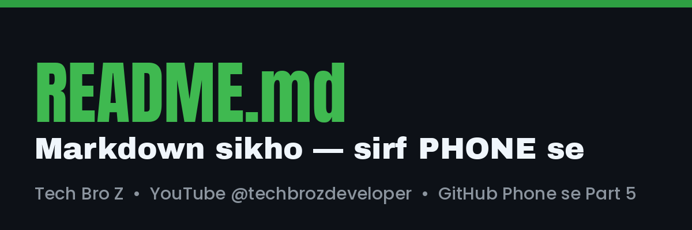

# Mera Pehla README 📘

Ye repo **GitHub Phone se — Part 5** ka demo hai. Yahan hum phone se README.md likhna seekh rahe hain.

## Is project mein kya hai?

Ye ek **demo** project hai. Isme hum *Markdown* ke saare basic tricks try kar rahe hain.

### Features
- Phone se banaya
- Free hai
- Beginners ke liye

### Steps
1. Repo banao
2. README.md kholo
3. Markdown likho aur commit karo

## Links aur Image

YouTube channel: [Tech Bro Z Coding](https://www.youtube.com/@techbrozdeveloper)



## Code kaise dikhaye

```html
<h1>Hello Duniya</h1>
<p>Mera pehla page</p>
```

## Table

| Topic | Part | Status |
|-------|------|--------|
| Repo banana | Part 2 | ✅ |
| Issues + PR | Part 3 | ✅ |
| GitHub Pages | Part 4 | ✅ |
| README | Part 5 | ✅ |

## To-do list

- [x] README banaya
- [x] Image lagayi
- [ ] Apna profile README banana

## Badges

 

> [!TIP]
> README hi kisi bhi repo ka **pehla impression** hota hai.

<details>
<summary>Bonus: Click karo 👇</summary>

Har project mein README zaroor likho: kya hai, kaise chalaye, screenshot.

</details>

---
Made by **Tech Bro Z** — YouTube [@techbrozdeveloper](https://www.youtube.com/@techbrozdeveloper) • Instagram @tech_bro_z_1
